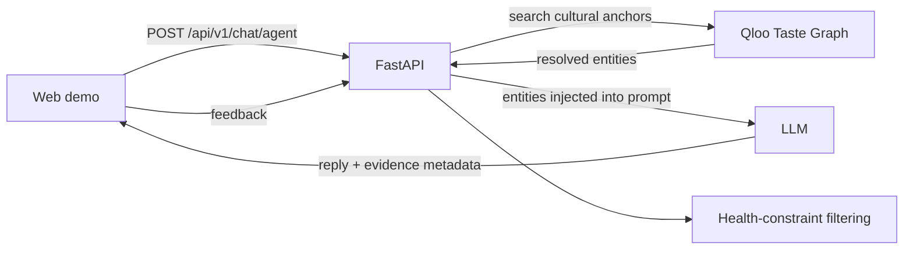

# TasteCare — Culturally Intelligent Dining for Older Adults

> **Healthy advice only works when it still feels like your food.**

> Qloo is not an enrichment layer in TasteCare. It is the reason the product can distinguish "healthy food this person might tolerate" from "food this person would recognize as their own."

TasteCare uses Qloo's cultural taste graph to help an older adult find meals that fit both their tastes and their health constraints. Without Qloo, an LLM can suggest generic healthy meals. With Qloo, the agent can resolve cultural anchors—such as Frank Sinatra and Italian cuisine—into real entities, use them to ground its response, and show that evidence to the user.

## 30-second judge path

1. Open the hosted demo. The Senior Dining tab automatically loads Maria's profile.
2. Click **"Find Meals She'd Actually Love"**.
3. Look for the green **Qloo taste graph — recommendations grounded live** badge and the grounding panel under the answer. The panel lists the resolved cultural anchors; it currently shows honest preview placeholders while the backend `taste_entities`/`qloo_context` passthrough ships.
4. Switch to the **"Why Qloo"** tab and compare side-by-side:
   - **With Qloo** — culturally grounded recommendations powered by live Qloo knowledge base.
   - **Without Qloo** — controlled generic LLM baseline (static reference output for ablation comparison, not a second live runtime call).

## 30-second demo

**Hosted demo:** _Add the public demo URL after deployment._  
**Demo video/GIF:** _Add a short recording of the Qloo evidence panel and recommendation._

Try: **“My 80-year-old dad loves Frank Sinatra and Italian food but needs low-sodium meals. What would he enjoy?”**

The Agent tab shows the cultural entities returned by Qloo beneath the response when live entities resolve. The panel labels live Qloo evidence distinctly from preview data; the UI must not imply that preview data came from Qloo.

## Why Qloo?

**TasteCare without Qloo is a generic diet assistant.**  
TasteCare with Qloo connects identity, culture, and health constraints in one recommendation. Without Qloo's preference grounding, the model generates generic "healthy" suggestions that ignore cultural identity and personal dietary boundaries for older adults.

Meet Maria: she grew up in New York's Little Italy with garlic, basil, and Sinatra on the radio. Now she needs easy-to-chew, lower-sodium meals and must consider medication-related food constraints.

A generic LLM might suggest grilled chicken, steamed vegetables, and oatmeal. That may be nutritionally plausible, but it ignores what makes a meal feel familiar and appealing. TasteCare resolves cultural anchors through Qloo, passes the resulting entities into the LLM context, and applies health constraints separately. The point is not to claim Qloo establishes medical safety; it supplies a cultural signal that a generic health list lacks.

| Without Qloo | With Qloo |
|---|---|
| Generic healthy-meal suggestions | Recommendations grounded in resolved cultural anchors |
| The model guesses from its general knowledge | Qloo entities are retrieved and exposed as evidence |
| No explicit cross-domain taste signal | Cultural links can connect music, film, dining, and more |

## How it works



For `/api/v1/chat/agent`, the backend extracts cultural likes, resolves them with `search_cultural_entities()`, injects matching entities into the LLM prompt, and returns `taste_entities`, `taste_data_source`, and `qloo_context`. The web Agent tab renders the evidence panel when resolved entities are present. A live panel requires a configured Qloo key and actual Qloo results; missing credentials or unresolved entities are not presented as live grounding.

Additional Qloo capabilities include entity search, taste-based recommendations, cross-domain discovery, cultural-fit scoring, and TasteCare dining recommendations. Cultural matching and health constraints are separate signals. This prototype does not provide medical advice.

## Run locally

Requirements: Python 3.12+ and Node.js 20+.

1. Configure `apps/server/.env` with `QLOO_API_KEY`, `LLM_API_KEY`, and `QLOO_BASE_URL=https://hackathon.api.qloo.com`. Keep credentials in environment variables; never commit `.env` files or API keys.
2. Start the backend:

```bash
cd apps/server
pip install -r requirements.txt
python -m uvicorn app.main:app --host 127.0.0.1 --port 8000
```

3. In a second terminal, start the web app:

```bash
pnpm install
pnpm --dir apps/web dev
```

Open `http://localhost:3000`. Set `VITE_API_BASE` to the backend URL when the development proxy is not used.

## Verify grounding

```bash
cd apps/server
python -m pytest tests/test_chat_agent_qloo_grounding.py -q
```

These focused tests cover entity resolution, prompt injection, response metadata, and the disabled-Qloo path. The backend also includes offline tests and optional live-Qloo tests that require a valid API key.

## Deploy

The hackathon submission requires an externally hosted demo. Deploy `apps/server` as a FastAPI service (Railway, Render, or Fly.io) and `apps/web` to Vercel or Netlify. Configure `QLOO_API_KEY` and `LLM_API_KEY` as server-side secrets, set `CORS_ALLOW_ALL=false`, and set `CORS_ORIGINS` to the exact deployed web origin. Set `VITE_API_BASE` to the backend URL at frontend build time.

**Hosted demo:** _Add the public URL after deployment._

## License

MIT — see [LICENSE](./LICENSE).

## Medical disclaimer

TasteCare is a hackathon prototype for demonstration only. It is not medical software, a licensed medical device, a dietitian, or a clinical recommendation system. Do not use it to diagnose, treat, or make decisions about health, medication, or diet without consulting a qualified professional. AI-generated recommendations may be inaccurate or unsafe; users must independently verify them.
