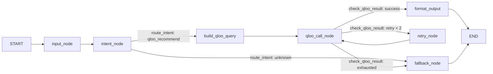
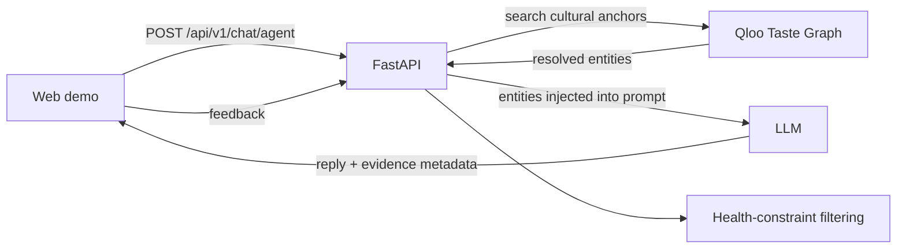

# TasteCare — Culturally Intelligent Dining for Older Adults

> **Healthy advice only works when it still feels like your food.**

> Qloo is not an enrichment layer in TasteCare. It is the reason the product can distinguish "healthy food this person might tolerate" from "food this person would recognize as their own."

TasteCare uses Qloo's cultural taste graph to help an older adult find meals that fit both their tastes and their health constraints. Without Qloo, an LLM can suggest generic healthy meals. With Qloo, the agent can resolve cultural anchors—such as Frank Sinatra and Italian cuisine—into real entities, use them to ground its response, and show that evidence to the user.

## 30-second judge path

1. Open the hosted demo. A global **PersonaPicker** at the top shows Maria (the built-in preset) — or switch to a custom person you create (name, taste anchors, health constraints, location). The whole app binds to that one person; the persona id and any custom profiles are persisted in `localStorage`, so a page reload lands back on the SAME person (tab position rides the URL hash).
2. The Senior Dining tab is the **ONE DEMO**: a 🚀 strip at the top maps the whole journey — Persona → Search & Health Screening → Taste Bridge → Evidence — with a one-click link to the ⚖️ Evidence tab. A green **🛡️ Health screening passed** band names the active constraints (low-sodium, easy-to-chew, medication-aware) above every screened meal.
3. Click **"Try Maria's Story"** (or the custom person's story) — a one-line process strip shows the real Qloo query lifecycle (`⏳ Querying Qloo Taste Graph… → ✓ N entities matched (T s)`), followed by the screening band and the grounded recommendations.
4. Look for the green **Qloo taste graph — recommendations grounded live** badge and the grounding panel under the answer. The panel lists the resolved cultural anchors with their **real Qloo match scores** (e.g. "92%"); a **Taste Bridge** constellation on the first screen animates nodes + edges on arrival and re-centers on whatever persona is selected — the same reusable bridge the Discover tab draws, with a compact persona Journey strip underneath that mirrors the constellation exactly.
5. The 💡 Tastes tab is now the persona's **taste profile**: click any anchor (or search result) to instantly recommend for it — and the domain pills instantly re-filter both search results and recommendations. The Community tab shows **"Matching as {persona}"** with a one-click button that reuses the persona's anchors in the peer matcher; connections are stored in a lightweight server-side JSON file and survive restarts.
6. Open the **⚖️ Evidence** tab (Why Qloo + Ablation stacked in one place) and compare:
   - **With Qloo** — culturally grounded recommendations powered by live Qloo knowledge base.
   - **Without Qloo** — controlled generic LLM baseline (static reference output for ablation comparison, not a second live runtime call).

## 30-second demo

**Hosted demo:** _Add the public demo URL after deployment._  
**Demo video/GIF:** _Add a short recording of the Qloo evidence panel and recommendation._

Try: **“My 80-year-old dad loves Frank Sinatra and Italian food but needs low-sodium meals. What would he enjoy?”**

The Agent tab shows the cultural entities returned by Qloo beneath the response when live entities resolve. The panel labels live Qloo evidence distinctly from preview data; the UI must not imply that preview data came from Qloo.

## Why Qloo?

**TasteCare without Qloo is a generic diet assistant.**  
TasteCare with Qloo connects identity, culture, and health constraints in one recommendation. Without Qloo's preference grounding, the model generates generic "healthy" suggestions that ignore cultural identity and personal dietary boundaries for older adults.

Meet Maria: she grew up in New York's Little Italy with garlic, basil, and Sinatra on the radio. Now she needs easy-to-chew, lower-sodium meals and must consider medication-related food constraints.

A generic LLM might suggest grilled chicken, steamed vegetables, and oatmeal. That may be nutritionally plausible, but it ignores what makes a meal feel familiar and appealing. TasteCare resolves cultural anchors through Qloo, passes the resulting entities into the LLM context, and applies health constraints separately. The point is not to claim Qloo establishes medical safety; it supplies a cultural signal that a generic health list lacks.

| Without Qloo | With Qloo |
|---|---|
| Generic healthy-meal suggestions | Recommendations grounded in resolved cultural anchors |
| The model guesses from its general knowledge | Qloo entities are retrieved and exposed as evidence |
| No explicit cross-domain taste signal | Cultural links can connect music, film, dining, and more |

## Agent framework

Our core recommendation workflow (`/api/v1/chat/agent`) is orchestrated with **LangGraph StateGraph**, with conditional intent routing and an automatic retry/fallback loop. The live path runs a purpose-built Qloo agent graph compiled from the same `qloo_cultural_recommend_node` that powers the full pipeline:



- **`intent_node` → `route_intent`**: keyword-based intent classification (rule-only — **no local LLM**). Qloo-related messages (dining / recommend / taste signals) enter the Qloo branch; anything else degrades to `fallback_node`.
- **`qloo_call_node`**: the live Qloo taste-graph call (entity search → taste-based recommendations → cross-domain discovery → LLM context). It degrades gracefully: a transient error or an empty result triggers up to **2 automatic retries** through `retry_node`, then `fallback_node` falls back to honest preview/preference-only grounding.
- **Execution**: `/chat/agent` builds an `AgentState` and awaits `graph.ainvoke(...)` on the compiled graph — real agent-framework scheduling, not a hand-rolled call. If graph execution ever fails, the endpoint degrades to awaiting the same `qloo_cultural_recommend_node` directly; it never hard-fails.
- **Red lines**: the graph compiles **without a checkpointer** (no session persistence — every run is a single request), and intent routing stays rule-based.

The graph topology above is generated by `draw_mermaid()` in `app/services/graph/graph.py`; `build_qloo_agent_graph()` builds it and is exercised end-to-end in `app/services/graph/tests/test_qloo_agent_workflow.py`.

## Documentation

Deep-dives into how this is built — every diagram generated from the actual
code, not aspirational:

- **[docs/ARCHITECTURE.md](./docs/ARCHITECTURE.md)** — end-to-end system map: web demo, FastAPI agent workflow, Qloo taste graph, LLM provider, health-screening layers, community matching.
- **[docs/QLOO_AGENT_GRAPH.md](./docs/QLOO_AGENT_GRAPH.md)** — the LangGraph `StateGraph` topology, intent-routing rules, and the retry decision table, exported by `draw_mermaid()`.
- **[docs/ABLATION_EXPERIMENT.md](./docs/ABLATION_EXPERIMENT.md)** — how we prove the difference is Qloo (unit-level + demo-level ablation).

## Scaling architecture

Peer matching uses **lightweight numpy vector search for demo** (sentence-transformers + all-MiniLM-L6-v2 local model, plain numpy cosine similarity — **no FAISS in the hot path**). A fully-tested **FAISS IndexFlatIP scaling plan** is pre-written as offline expansion code in `app/services/community/faiss_scaleout.py`, ready to be enabled once peer count exceeds 1000. The final ranking always reuses the exact health-constraint `_score`, so safety semantics never change at any scale.

## Ablation experiment — the difference is Qloo, measured

We implement strict **single-variable ablation** at two levels to prove the
performance gap comes from Qloo grounding and nothing else:

1. **Unit level** — `tests/test_chat_ablation_consistency.py` holds the system
   prompt, taste-profile likes, temperature, and task type constant and toggles
   only the `[Qloo Cultural Context]` block. The with-Qloo branch and the
   `disable_qloo=true` baseline fire with identical session/profile state; the
   test asserts the ONLY difference is the Qloo grounding block itself.
2. **Demo level** — `POST /api/v1/ablation/comparison` runs the same
   senior-dining prompts through Variant A (rule-based screening, **no Qloo**)
   and Variant B (the real Qloo TasteCare pipeline), sharing identical
   candidates, so the on-screen difference is exactly the cultural grounding.
   The web **⚖️ Evidence tab** (Ablation part) renders both side-by-side in one click with an
   honest live-vs-preview indicator.

Full methodology, the controlled-variable table, and validity threats are in
[`docs/ABLATION_EXPERIMENT.md`](./docs/ABLATION_EXPERIMENT.md).

## How it works



For `/api/v1/chat/agent`, the backend extracts cultural likes, resolves them with `search_cultural_entities()`, injects matching entities into the LLM prompt, and returns `taste_entities`, `taste_data_source`, and `qloo_context`. The web Agent tab renders the evidence panel when resolved entities are present. A live panel requires a configured Qloo key and actual Qloo results; missing credentials or unresolved entities are not presented as live grounding.

Two final-contract behaviors keep the demo honest:

- **Fail loudly on location mismatch.** Dining recommendations are verified against the requested city. Venues with no verifiable city signal are surfaced as mismatches *in the reply* (never silently substituted, never dropped without a report); non-dining entities are always kept.
- **Real match scores, passthrough only.** The grounding panel shows Qloo's actual `score`/`popularity` as percentages (e.g. "92%") for resolved entities. When Qloo supplies neither, the score badge is simply omitted — the UI never fabricates a number.

Additional Qloo capabilities include entity search, taste-based recommendations, cross-domain discovery, cultural-fit scoring, and TasteCare dining recommendations. Cultural matching and health constraints are separate signals. This prototype does not provide medical advice.

## Run locally

Requirements: Python 3.12+ and Node.js 20+.

1. Configure `apps/server/.env` with `QLOO_API_KEY`, `LLM_API_KEY`, and `QLOO_BASE_URL=https://hackathon.api.qloo.com`. Keep credentials in environment variables; never commit `.env` files or API keys.
2. Start the backend:

```bash
cd apps/server
pip install -r requirements.txt
python -m uvicorn app.main:app --host 127.0.0.1 --port 8000
```

3. In a second terminal, start the web app:

```bash
pnpm install
pnpm --dir apps/web dev
```

Open `http://localhost:3000`. Set `VITE_API_BASE` to the backend URL when the development proxy is not used.

## Verify grounding

```bash
cd apps/server
python -m pytest tests/test_chat_agent_qloo_grounding.py -q
```

These focused tests cover entity resolution, prompt injection, response metadata, the disabled-Qloo path, **match-score passthrough into the reply context**, **city-token location detection**, and the **fail-loud `_verify_dining_location` guard** (mismatches reported, never dropped). The backend also includes offline tests and optional live-Qloo tests that require a valid API key.

## Deploy

The hackathon submission requires an externally hosted demo. Deploy `apps/server` as a FastAPI service (Railway, Render, or Fly.io) and `apps/web` to Vercel or Netlify. Configure `QLOO_API_KEY` and `LLM_API_KEY` as server-side secrets, set `CORS_ALLOW_ALL=false`, and set `CORS_ORIGINS` to the exact deployed web origin. Set `VITE_API_BASE` to the backend URL at frontend build time.

**Hosted demo:** _Add the public URL after deployment._

## License

MIT — see [LICENSE](./LICENSE).

## Medical disclaimer

TasteCare is a hackathon prototype for demonstration only. It is not medical software, a licensed medical device, a dietitian, or a clinical recommendation system. Do not use it to diagnose, treat, or make decisions about health, medication, or diet without consulting a qualified professional. AI-generated recommendations may be inaccurate or unsafe; users must independently verify them.
