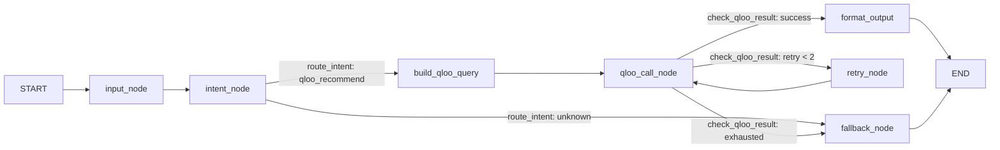

# B档：Qloo Agent 完整编排图（意图分支 + 重试回环 + 格式化/回退）

> 状态：**已完成**（2026-10-16 落地，`build_qloo_agent_graph()` 已接入 `/api/v1/chat/agent` live 分支）。

## 目标

在 A档最简可编译图（`START → route_main_flow → qloo_cultural_recommend_node → END`）之上，
补齐计划书要求的 agent-framework 能力展示：

- 意图分支：`intent_node`（规则关键词分类）→ `route_intent`（qloo 意图 → Qloo 分支；
  unknown → fallback）。
- 重试回环：`qloo_call_node` 失败 / 空结果 → `retry_node`（最多 2 次）→ 成功 `format_output`，
  耗尽 `fallback_node`。
- 状态字段完整：`qloo_query`、`qloo_raw_response`、`fallback_message`、`retry_triggered`、
  `qloo_retry_reason`。
- 可视化：`draw_mermaid()` 输出拓扑文本，README 与图一致。

## 拓扑（与 draw_mermaid() 一致）

## 红线（全部守住）

- compile() 不传 checkpointer —— 不开启会话持久化（A/B 两档均无）。
- 意图识别仅规则关键词（`checkers.classify_intent`），不引入本地 LLM / Ollama。
- A档保底路径保留：`build_agent_graph(minimal=True)` 不变；`/chat/agent` 外层 try/except
  在图执行失败时降级为直接 `await qloo_cultural_recommend_node`，永不 hard-fail。
- FAISS / 健康约束 / UI / 消融面板 / a11y 一律未动。

## 变更文件

- `app/services/graph/state.py`：AgentState + init_state 新增 5 个 B档字段。
- `app/services/graph/checkers.py`：`classify_intent` / `route_intent` / `check_qloo_result`；
  3 个历史存根保留。
- `app/services/graph/nodes.py`：`input_node` / `intent_node` / `build_qloo_query` /
  `qloo_call_node`（复用 `qloo_cultural_recommend_node` 内部逻辑）/ `retry_node` /
  `format_output` / `fallback_node`。
- `app/services/graph/graph.py`：`build_qloo_agent_graph()` + `draw_mermaid()`。
- `app/services/graph/__init__.py`：包级导出 `build_qloo_agent_graph` / `draw_mermaid`。
- `app/api/chat.py`：live 分支切到 `build_qloo_agent_graph()`；保留直调兜底；
  记录 `fallback_message` 日志。
- 测试：新增 `app/services/graph/tests/test_qloo_agent_workflow.py`（28 条）；
  更新 `tests/test_chat_agent_qloo_grounding.py` 两条 ainvoke 断言与
  `test_minimal_agent.py` 存根 docstring。

## 验收记录

- 全量 pytest（含新增 workflow 28 条 + 原 495 条）通过。
- 决策表：成功→format_output；瞬时错误/空结果→retry（≤2）；耗尽→fallback；
  无 key→fallback（不重试）。
- `/chat/agent` 响应契约未变：`taste_data_source==""`（无 live 数据时）与既有测试
  （`test_chat_agent_no_grounding_when_qloo_disabled`）保持一致；图的内部
  `taste_data_source=preview` 仅作图内可观测标记，不泄漏进响应。

## 评委 FAQ：为什么没有"记忆"？

- **Checkpointer / 会话持久化 = 单请求多轮跨请求状态持久化，本项目明确不做**（A/B 两档
  `compile()` 均不传 checkpointer，有测试断言 `checkpointer is None`）。
- **用户偏好画像（年龄 / 咀嚼 / 忌口 / 口味）由现有 profile 结构承载**——`chat.py` 从
  profile 提取 `cultural_likes` / `target_domain` / `health_constraints` 流入 AgentState
  作为单请求输入；这不是 LangGraph Checkpointer，而是"记住用户是谁"的数据来源。
- 对外话术："状态流转限定在单请求内以保持 demo 轻量；用户的偏好画像由现有 profile
  结构承载，跨会话记忆不是本 demo 的 hook。"——把"没做 Checkpointer"讲成设计取舍。
