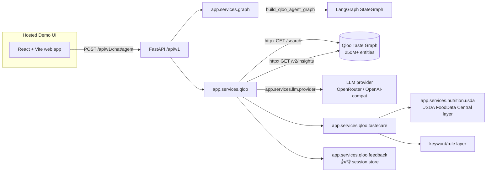
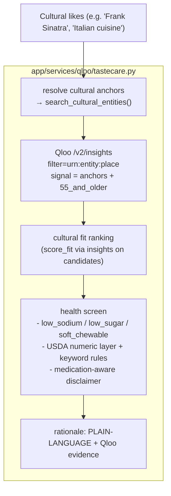
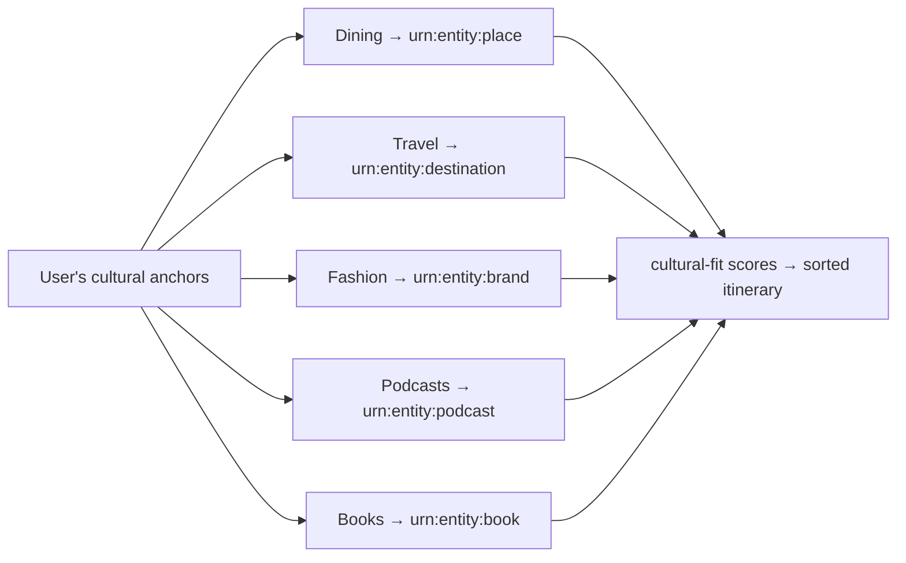

# Architecture

TasteCare is a culturally intelligent dining agent for older adults. Cultural
grounding is not an enrichment layer — it is the product's reason to exist.
This document maps every arrow to real code.

## System overview

## Component inventory (all real files)

| Concern | Module | Responsibility |
|---|---|---|
| API surface | `app/api/chat.py`, `app/api/qloo.py`, `app/api/tastecare.py`, `app/api/ablation.py`, `app/api/community.py` | Routers mounted under `/api/v1` in `app/main.py` |
| Agent orchestration | `app/services/graph/graph.py`, `nodes.py`, `checkers.py`, `state.py` | LangGraph `StateGraph` with intent routing + retry loop |
| Qloo client | `app/services/qloo/client.py`, `config.py`, `cache.py` | `httpx` wrapper for `/search`, `/v2/tags`, `/v2/insights`; GET caching keyed by `base_url + params`; retry + typed error mapping |
| Qloo taste logic | `app/services/qloo/taste.py`, `entities.py` | Entity resolution, taste-based recommendations, cross-domain discovery, cultural-fit scoring, LLM context building |
| TasteCare dining | `app/services/qloo/tastecare.py` | Resolve cultural anchors → Qloo PLACE insights with `55_and_older` demographic → health screen → plain-language rationale |
| Health screening | `app/services/nutrition/usda.py` | USDA numeric layer (sodium/protein/fiber/calories) stacked on keyword rules; medication table is a small explicit whitelist |
| Ablation | `app/services/eval/ablation.py` | Paired Variant A (rules, no Qloo) vs Variant B (Qloo pipeline) over identical candidates |
| Community | `app/services/community/matcher.py` | Qloo-powered peer matching: likes resolved via `/search`, affinity = shared resolved anchors + shared constraints |
| Feedback | `app/services/qloo/feedback.py` | Session-scoped 👍/👎 store; likes feed back into the taste profile |
| Frontend | `apps/web/src/*` | React + Vite TS app; 8 tabs mirror the backend capabilities |

## The TasteCare recommendation pipeline

Every dining candidate must pass BOTH gates: it must be anchored to the
person's real taste (Qloo) **and** pass the health screen (USDA + rules).
Neither gate alone is the product.

## Cross-domain discovery (Taste Bridge)

Implemented by `build_multi_domain_itinerary()` in `tastecare.py` — one
`/v2/insights` call per domain, anchored on the same resolved entities.

## Resilience

- The httpx client retries transient errors up to `QLOO_MAX_RETRIES`, maps
  401/403/400/404 to typed errors, and never raises to the caller.
- GET queries are cached in-memory, keyed by `(method, path, base_url,
  params)` so the hackathon and production environments never share stale data.
- The agent graph has an automatic retry loop for transient Qloo failures and
  a rule-only fallback when Qloo is disabled — see
  [QLOO_AGENT_GRAPH.md](./QLOO_AGENT_GRAPH.md).
- Without an LLM key the system still answers from the Qloo taste graph
  (Qloo-only mode) — the demo never hard-fails on a fresh checkout.