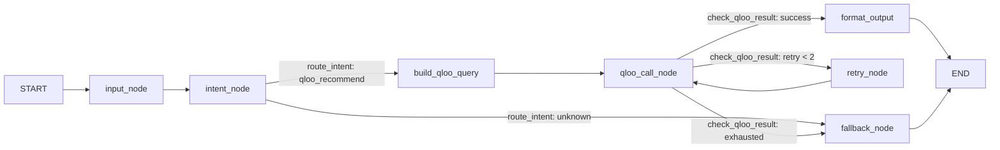

# The Qloo Agent Graph (LangGraph)

`/api/v1/chat/agent` executes a real **LangGraph `StateGraph`**: conditional
intent routing, an automatic retry loop, and a rule-based fallback — not a
prompt wrapper.

Source of truth:
- `apps/server/app/services/graph/graph.py` — `build_qloo_agent_graph()`
- `apps/server/app/services/graph/checkers.py` — `classify_intent`,
  `route_intent`, `check_qloo_result`
- `apps/server/app/services/graph/nodes.py` — `input_node`, `intent_node`,
  `build_qloo_query`, `qloo_call_node`, `retry_node`, `format_output`,
  `fallback_node`

## Topology (exported, not hand-drawn)

This exact text is returned by `app.services.graph.draw_mermaid()` and asserted
in `app/services/graph/tests/test_qloo_agent_workflow.py`, so the diagram can
never drift from the code.

## Intent routing — rules, not an LLM

`classify_intent()` matches word-boundary English culinary keywords and Chinese
substrings. It is deliberately LLM-free so the demo is deterministic and cheap:

| Input | Intent |
|---|---|
| "Recommend a dinner for Maria" (contains "recommend"/"dinner") | `qloo_recommend` |
| "My grandpa loves Frank Sinatra and Italian food…" | `qloo_recommend` |
| "请推荐适合老年人的低盐晚餐" (contains 推荐) | `qloo_recommend` |
| "What's the weather today?" | `unknown` → `fallback_node` |

`route_intent` defensively re-classifies when the intent field is missing from
state, so the graph never misroutes on a state-merge glitch.

## Retry decision table — `check_qloo_result`

| Condition | Route |
|---|---|
| `last_error` set, `retry_count < 2` | → `retry_node` |
| `last_error` set, retries exhausted | → `fallback_node` |
| Qloo disabled (no key) | → `fallback_node` (retrying is pointless) |
| Empty result (no resolved entities, no recommendations), retries left | → `retry_node` |
| Empty result, retries exhausted | → `fallback_node` |
| Success | → `format_output` |

## State contract

The graph uses `AgentState` (`state.py`) with TasteCare-specific fields:
`qloo_resolved_names`, `qloo_recommendations`, `qloo_taste_context`,
`taste_entities`, `taste_data_source`, `health_constraints`,
`filtered_recommendations`. Nodes return fresh dicts — they never mutate state.

## Why this satisfies "built using an agent framework"

The evidence panel in the web demo (green "Qloo taste graph — recommendations
grounded live" badge) is backed by genuine graph execution:
`taste_context_extract → health_constraint_extract → qloo_cultural_recommend_node`.
When the graph encounters a transient Qloo error it actually **retries through
the loop**; when Qloo is down it degrades to a rule-only fallback instead of
crashing — behaviors that are unit-tested in `test_qloo_agent_workflow.py`.